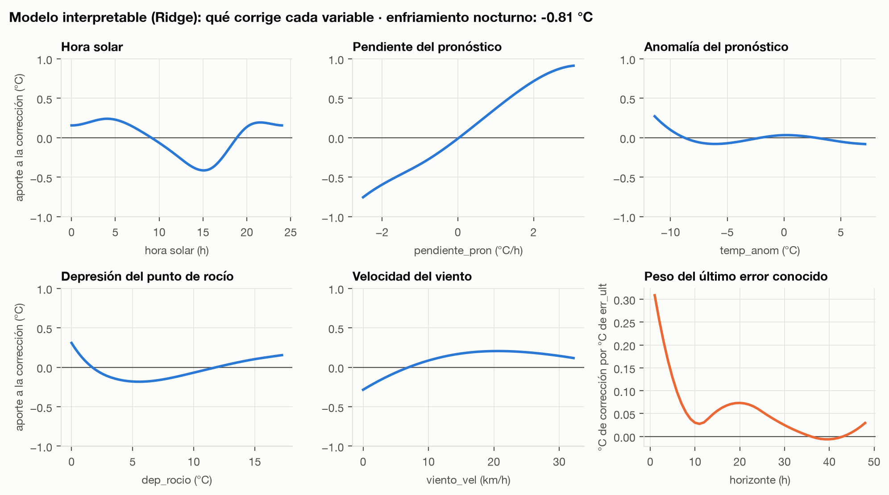
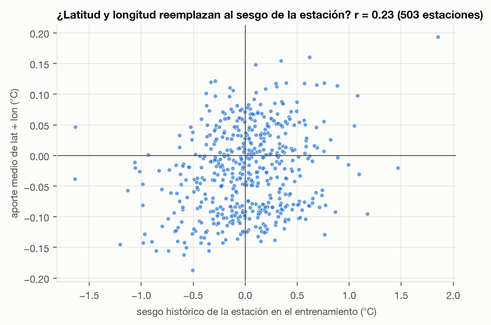
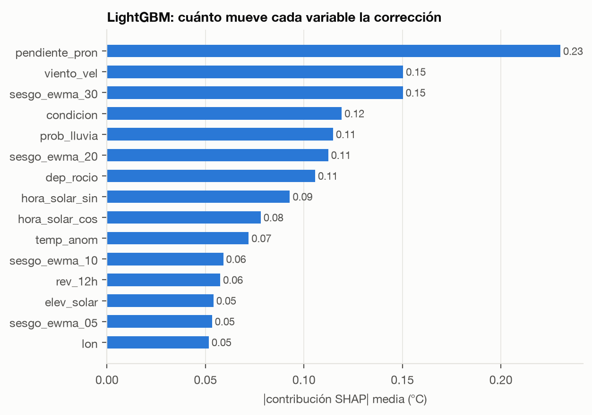
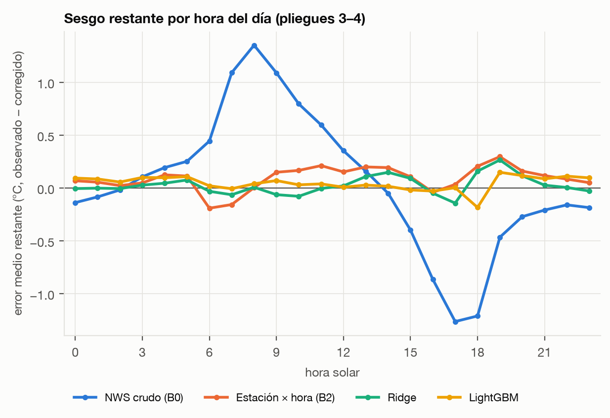
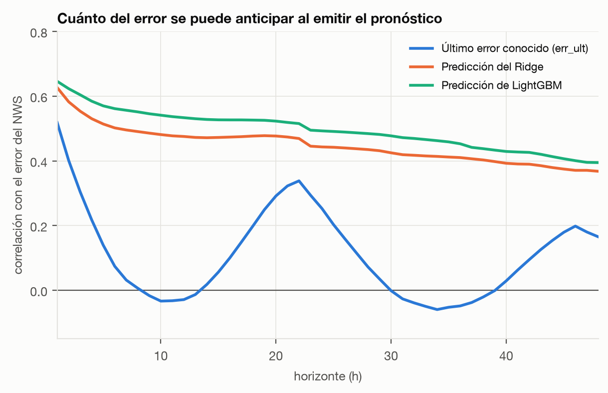

```{python}
import pandas as pd
from pathlib import Path
from IPython.display import Markdown

S = Path("../salidas")
HORIZ = ["todos", "1", "3", "6", "12", "24", "48"]

def c(x, d=3):
    """Número con coma decimal."""
    return f"{x:.{d}f}".replace(".", ",")

def mae(modelo_csv, segmento="todas"):
    df = pd.read_csv(S / modelo_csv / "por_pliegue.csv", dtype={"horizonte": str})
    df = df[df.segmento == segmento]
    return df.groupby(["modelo", "horizonte"]).MAE.mean().unstack(0)

r, l = mae("ridge"), mae("lgbm")
tabla = pd.DataFrame({"B0": r["B0"], "B2": r["B2"], "Ridge": r["lineal"], "LightGBM": l["lgbm"]}).loc[HORIZ]
```

::: {.callout-note}
## Fuentes de este informe
Los gráficos y las tablas de las secciones 3.3 a 6 vienen de [`notebooks/comparacion_modelos.ipynb`](../notebooks/comparacion_modelos.ipynb). Se insertan desde las salidas guardadas en la notebook, sin copiarlas. Esas tablas usan punto decimal.

Las figuras de interpretación vienen de `figuras/`, que genera [`src/interpretar.py`](../src/interpretar.py). La tabla de MAE por horizonte se calcula al renderizar, desde `salidas/<modelo>/por_pliegue.csv`.
:::

# Problema y datos

El NWS publica pronósticos horarios de temperatura. Queremos **corregirlos**: predecir el error `observado − pronosticado` y sumárselo al pronóstico. Un error positivo quiere decir que el pronóstico quedó corto.

- **Datos:** el dataset fusionado del TP1. Abarca 55 días (10/09 → 09/11/2026), 516 estaciones de 23 estados del Este de EE.UU. y horizontes de 1 a 48 h, con 32,6 M de filas (estación × hora objetivo × horizonte).
- **Variables:** se agrupan en 8 familias, y todas se conocen al emitir el pronóstico. Una prueba automática controla que ningún error rezagado venga del futuro ([`src/verificar_features.py`](../src/verificar_features.py)).

| Familia | Qué contiene |
|---|---|
| base | El pronóstico (temperatura, humedad, rocío, viento, condición, probabilidad de lluvia), la hora solar, la elevación del sol, la latitud y la longitud |
| pendiente | La pendiente del pronóstico (°C/h) |
| rezagos | El último error conocido al emitir el pronóstico, sus medias de 3 y 6 h y el error de ayer a la misma hora |
| sesgo EWMA | El sesgo de la estación, como promedio exponencial (α = 0,05; 0,1; 0,2; 0,3) |
| vecinos, revisión, rezagos extra, dinámica | Error de estaciones cercanas, cambios entre emisiones y tendencias recientes |

**Métrica principal:** MAE de la temperatura corregida, en °C, medida sobre observaciones reales (no interpoladas). La sección 4 agrega RMSE, sesgo y percentiles.

**Referencias a superar:**

- **B0** es el NWS sin corregir.
- **B2** es el error medio de la estación a esa hora solar. Es una tabla de promedios y el mejor baseline sin ML.

# Validación cruzada

Usamos **walk-forward** con ventana expansiva, cortes por día de la hora objetivo y 2 días de gap. No usamos k-fold con mezcla, por dos razones: los errores están autocorrelacionados en el tiempo, y cada hora objetivo aparece hasta 48 veces, una por horizonte.

- **Pliegues:** hay 5, anclados al 30/09/2026, con 5 días de prueba cada uno.
- **Pliegues 1–2:** eligen los hiperparámetros de cada modelo, que después quedan congelados.
- **Pliegues 3–5 (15 días de prueba):** reportan las métricas. Ningún modelo los usó para elegir nada.
- **Código:** [`src/validacion.py`](../src/validacion.py).

# Los dos modelos

## Modelo que prioriza la interpretabilidad: Ridge con curvas

Script: [`src/modelos/ridge.py`](../src/modelos/ridge.py). Salidas: [`salidas/ridge/`](../salidas/ridge/).

Es una regresión lineal regularizada. Las variables con efecto no lineal entran como **splines**, así que cada término se lee como una curva en °C. Tienen curva:

- la hora solar, con un spline periódico;
- la pendiente del pronóstico;
- la anomalía del pronóstico;
- la depresión del punto de rocío;
- la velocidad del viento.

Además tiene:

- **Un indicador físico** de enfriamiento nocturno: noche × despejado × viento < 10 km/h.
- **Interacciones:** el último error conocido, con un peso que depende del horizonte, y el sesgo × noche.

**Familias:** usa 5 de las 8 (base, pendiente, rezagos, sesgo EWMA y revisión). Las eligió una **regla de recorte fijada antes de ver los resultados** (`notebooks/experimentos.ipynb`): se saca una familia si, sin ella, el MAE de elección no empeora más de 0,005 °C de promedio ni más de 0,010 °C en ningún pliegue.

**Hiperparámetro:** la penalización α se eligió en una grilla de 1 a 10⁷. La elegida fue **α = 10⁵**.

## Modelo que prioriza minimizar el error: LightGBM

Script: [`src/modelos/lgbm.py`](../src/modelos/lgbm.py). Salidas: [`salidas/lgbm/`](../salidas/lgbm/).

Son árboles de gradient boosting con **las 8 familias** (51 variables), sin imputar faltantes y con la condición del tiempo como variable categórica. No usa el identificador de la estación: el sesgo de cada estación entra por los sesgos EWMA.

**Grilla de hiperparámetros:**

- `num_leaves` ∈ {31, 127};
- pérdida L2 o L1;
- de 50 a 500 árboles, en pasos de 50.

**Elegido:** 127 hojas, pérdida **L1** y **150 árboles**.

## Elección de hiperparámetros y estabilidad entre pliegues

El gráfico de la izquierda muestra el MAE de cada configuración de LightGBM según la cantidad de árboles, en los pliegues de elección. El de la derecha muestra la mejora sobre B0 en cada pliegue. Si el modelo se hubiera sobreajustado a la elección, la mejora caería en los pliegues de reporte. El gráfico llega hasta el pliegue 4; el 5 está en la tabla de abajo.



# Comparación de performance

## Métricas globales



- **Mejora sobre el NWS crudo:** el Ridge baja el MAE un 11,7 % y LightGBM un 15,0 %. Los dos ganan en cada uno de los tres pliegues de reporte, y también le ganan a B2.
- **Las colas mejoran menos que el centro.** El RMSE baja un 13 % con LightGBM, pero el P99 de |error| solo un 5 % (5,00 → 4,74 °C). Los modelos corrigen sobre todo los errores chicos y medianos.
- **Errores grandes:** la fracción de filas con |error| > 3 °C baja de 11,4 % a 8,2 % (Ridge) y a 7,6 % (LightGBM).
- **Sesgo:** LightGBM conserva más sesgo medio que el Ridge (0,055 contra 0,026 °C), aunque menos que el NWS (0,106 °C). Es coherente con la pérdida L1 que eligió, que apunta a la mediana del error y no a la media.

## Error según el horizonte

```{python}
#| label: tbl-mae
#| tbl-cap: "MAE (°C) por horizonte. Promedio de los pliegues de reporte 3–5, todos los días de prueba."
t = tabla.copy()
t.index = ["todos"] + [f"{h} h" for h in HORIZ[1:]]
filas = ["| Horizonte | B0 NWS | B2 | Ridge | LightGBM |", "|---|---|---|---|---|"]
for h, f in t.iterrows():
    filas.append(f"| {h} | {c(f.B0)} | {c(f.B2)} | {c(f.Ridge)} | **{c(f.LightGBM)}** |")
Markdown("\n".join(filas))
```



```{python}
d = lambda h: c(tabla.loc[h, "Ridge"] - tabla.loc[h, "LightGBM"])
Markdown(
    f"- **La ventaja sobre B2 se concentra en los primeros horizontes.** Ahí sirve el error reciente de la estación: a 1 h, "
    f"el Ridge baja el MAE de {c(tabla.loc['1','B2'])} a {c(tabla.loc['1','Ridge'])} °C. A 48 h, todos los modelos quedan "
    f"cerca de B2 ({c(tabla.loc['48','B2'])} contra {c(tabla.loc['48','LightGBM'])} °C).\n"
    f"- **LightGBM − Ridge:** {d('1')} °C a 1 h, {d('6')} a 6 h, {d('24')} a 24 h y {d('48')} a 48 h.\n"
    f"- **Escalón cerca de 22 h:** las curvas de los dos modelos muestran un salto ahí. No identificamos qué variable lo produce."
)
```

## ¿Las diferencias son reales o ruido?

Con millones de filas cualquier diferencia parece significativa, pero las filas de un mismo día **no son independientes**: comparten el mismo tiempo meteorológico. Por eso la unidad de la prueba es el **día de prueba**.

- **Días:** son 15, 7 con historia completa y 8 con historia incompleta.
- **Pruebas:** t pareado sobre la diferencia diaria de MAE (Diebold–Mariano con pérdida absoluta) y un IC 95 % por bootstrap de días.
- **Código:** [`src/comparar_modelos.py`](../src/comparar_modelos.py).



- **LightGBM − Ridge:** −0,051 °C por día (IC 95 % de −0,071 a −0,032). Gana 14 de 15 días, con p = 0,0002.
  - **Con historia completa** (la operación normal): −0,054 °C, 7 de 7 días, p = 0,0006.
- **Ridge − B2:** −0,080 °C, 14 de 15 días. Las dos mejoras son reales: el ML aporta sobre la tabla de promedios, y la caja negra aporta sobre el modelo lineal.
- **Tamaño:** la diferencia entre modelos (0,05 °C) es chica frente a la variación del MAE entre días, que es de décimas de grado.

## Dónde ayuda y dónde no

### Fila a fila



- **El error del NWS sale escalonado** (saltos de 5/9 °C) porque el NWS pronostica en °F enteros. Los modelos suman una corrección continua y suavizan la distribución.
- **Mejora en promedio, pero no en cada fila.** LightGBM mejora el 57 % de las filas y empeora el 38 %; el Ridge, el 55 % y el 39 %.
- **Empeoramientos grandes:** LightGBM empeora en más de 1 °C un 6,7 % de las filas, contra 5,5 % del Ridge. Corrige más fuerte, y a veces se equivoca más fuerte. Por eso el dashboard muestra una banda de confianza (sección 6).

### Según la condición del tiempo pronosticada



- **Despejado:** es la condición más frecuente y donde más ayuda la corrección (LightGBM −23 %, Ridge −18 %). Es consistente con el enfriamiento nocturno que identifica el Ridge (sección 5.2).
- **Lluvia y nublado:** casi no ayuda (6–8 %). Solo tenemos la probabilidad de lluvia, no la cantidad pronosticada.
- **Nieve:** son 13 mil filas de pocos episodios, así que su 31 % no es generalizable.

### Según la hora solar local



El NWS tiene un sesgo diurno marcado, que los dos modelos casi eliminan (sección 5.4).

### Por estación



- **Mejora generalizada:** LightGBM mejora el MAE en 499 de las 516 estaciones, con una mejora mediana de 14,5 %.
- **Estaciones donde empeora:** son 17. Algunas tienen pocas filas, como F1409 (CT, 5 924) o KJYL (GA, 2 477). El modelo no ve `station_id`: si una estación se comporta distinto del resto y tiene poca historia, no tiene cómo saberlo.

### Historia completa vs. incompleta



Un día tiene **historia incompleta** cuando le falta o se le excluyó alguno de los 3 días previos. En esos días parte de los rezagos queda vacía.

La mejora relativa es mayor en esos días (17 % contra 12 % para LightGBM), porque el NWS rinde peor en ellos (1,561 contra 1,519 °C). El segmento con historia completa es el que representa la operación normal.

# Interpretabilidad: qué aprendió cada modelo

Cada modelo se interpreta con una herramienta distinta:

- **Ridge:** sus coeficientes y curvas *son* el modelo, así que se leen directamente.
- **LightGBM:** necesita herramientas post hoc. Usamos la importancia por ganancia y **SHAP** (TreeSHAP, exacto en árboles) sobre 100 000 filas de prueba.

Las curvas y el SHAP salen del modelo del pliegue 5, que es el de entrenamiento más largo.

## ¿Ridge y LightGBM aprenden lo mismo?



- **Las dos correcciones están muy correlacionadas (0,845).** LightGBM corrige algo más fuerte que el Ridge: el desvío de su corrección es 1,00 °C, contra 0,87.
- **Los dos predicen solo una parte del error.** El desvío del error del NWS es 1,94 °C, el doble que la corrección.
- **Calibración:** el gráfico de la derecha compara la corrección media con el error real, por cuantiles. Las dos curvas siguen la diagonal, que es la calibración perfecta: cuando un modelo dice «sumá +1 °C», el error real promedio es cerca de +1 °C.

## Ridge: curvas en °C

{width=100%}

- **Enfriamiento nocturno: −0,81 °C.** En noches despejadas y calmas el NWS pronostica de más. Es la inversión por radiación.
- **Pendiente del pronóstico:** casi lineal, de −0,8 a +0,9 °C. Cuando el pronóstico sube rápido, la observación queda por encima.
- **Hora solar:** −0,4 °C a las 15 h y +0,2 °C de madrugada. Este efecto se suma al sesgo propio de cada estación.
- **Último error conocido:** su peso cae de 0,31 °C por °C a 1 h a menos de 0,05 a partir de 10 h. Coincide con la persistencia de unas 6 h que mide la autocorrelación del error (`DECISIONES.md`, Etapa A — Variables).
- **Viento y rocío:** efectos chicos (±0,3 °C).

## Qué variables usa cada modelo y si es estable



- **Los coeficientes del Ridge son estables:** su correlación entre los pliegues 3 y 4 es 0,956. Por eso su lectura no depende del período.
- **LightGBM usa mucho latitud y longitud.** Eso podría significar que identifica estaciones de forma encubierta. La figura de abajo lo descarta: el aporte medio de lat y lon por estación casi no se relaciona con el sesgo histórico de la estación (r = 0,23), mientras que los sesgos EWMA sí (r = 0,78). Lat y lon aportan un efecto regional.
- **Cuidado con la importancia por ganancia:** favorece a las variables continuas con muchos cortes posibles. Por eso la complementamos con SHAP.

{width=75%}

## LightGBM: SHAP

{width=75%}

- **Coinciden con el Ridge en lo esencial.** La variable dominante es la **pendiente del pronóstico** (0,23 °C). Después vienen el viento (0,15), el **sesgo de la estación** (sesgo EWMA con α = 0,3: 0,15), la condición del tiempo (0,12) y la probabilidad de lluvia (0,11).
- **Lo que no muestran las importancias** es *dónde* gana LightGBM sobre el Ridge. Eso lo muestran las secciones 4.2 y 4.4: sobre todo entre 3 y 24 h, y en casi todas las condiciones del tiempo (0,03–0,07 °C de MAE).

## ¿Se corrigió el sesgo sistemático?

{width=75%}

| Corrección | Amplitud del ciclo por hora (°C) | Desvío entre estaciones (°C) |
|---|---|---|
| NWS crudo (B0) | 2,62 | 0,49 |
| B2 | 0,49 | 0,35 |
| Ridge | 0,41 | 0,32 |
| LightGBM | 0,33 | 0,33 |

- **El ciclo diario del error del NWS casi desaparece** con los dos modelos.
- **El desvío que queda entre estaciones** incluye el ruido de promediar solo 15 días de prueba, así que no todo es sesgo sin corregir.

{width=75%}

**Cuánto del error se puede anticipar:**

- La correlación entre la corrección y el error real va de 0,63–0,65 a 1 h a 0,37–0,40 a 48 h. Los modelos explican entre el 14 % y el 42 % de la varianza del error.
- El último error conocido, solo, cae a ~0 entre 6 y 12 h.

# Banda de confianza

El dashboard muestra una banda P10–P90 del error que queda después de corregir. Se calibró en los pliegues 1–2 por tramo de horizonte × condición. Si estuviera bien calibrada, el 80 % de las observaciones de los pliegues de reporte caería dentro.



- **Cubre menos de lo prometido:** 73,7 % con el Ridge y 75,0 % con LightGBM.
- **La brecha es mayor** a horizontes largos y con lluvia.
- **Causa probable:** los pliegues de elección fueron semanas más fáciles que los de reporte. Una banda «80 %» que cubre 75 % es optimista, y el dashboard muestra la cobertura real junto a la esperada.

# Conclusiones

1. **¿El modelo complejo se justifica?**
   - LightGBM es el de menor error: MAE 1,310 °C, contra 1,361 del Ridge y 1,541 del NWS crudo.
   - Le gana al Ridge 14 de 15 días, y 7 de 7 con historia completa. La diferencia es real pero chica: 0,05 °C, cerca del 4 % del MAE.
2. **¿Cuánto aporta el ML sobre una tabla de promedios?**
   - B2 ya mejora 0,10 °C sobre el NWS.
   - El Ridge suma 0,08 °C más y LightGBM 0,13 °C, sobre todo en horizontes cortos.
3. **¿Qué aprendieron?** Los dos se apoyan en lo mismo:
   - la pendiente del pronóstico;
   - el sesgo propio de cada estación;
   - el enfriamiento nocturno en noches despejadas y calmas;
   - la persistencia del error durante pocas horas.

   El Ridge lo dice en °C y con curvas estables entre pliegues. Captura cerca del 80 % de la mejora de LightGBM (11,7 % contra 15,0 %).
4. **¿Dónde no sirve?** Con lluvia, en algunas estaciones (17 de 516 empeoran con LightGBM) y a 48 h, donde los modelos quedan cerca de B2.
5. **¿Es confiable fila a fila?** No del todo:
   - empeora el 38–39 % de las filas;
   - la banda de confianza cubre 75 % y no 80 %.

**Producto:** `config.yaml` (`producto.modelo`) define cuál de los dos modelos se entrena con todos los días. El dashboard permite ver la corrección de cualquiera de los dos.

**Limitaciones:**

- Son 55 días de un solo período (10/09 → 09/11/2026), sin invierno ni verano.
- Hay 15 días de reporte.
- No validamos dejando estaciones afuera, así que no sabemos qué pasa con estaciones nuevas.

# Reproducibilidad

| Qué | Dónde |
|---|---|
| Modelo interpretable | `src/modelos/ridge.py` → `salidas/ridge/` |
| Modelo de menor error | `src/modelos/lgbm.py` → `salidas/lgbm/` |
| Comparación (gráficos y tablas de este informe) | `notebooks/comparacion_modelos.ipynb` |
| Prueba por días | `src/comparar_modelos.py` |
| Interpretación | `src/interpretar.py` → `figuras/` |
| Dashboard | `app/dashboard.py` (instrucciones en `entregaTP3/dashboard.md`) |
| Decisiones | `DECISIONES.md` |
| Parámetros y entorno | `config.yaml`, `requirements.txt` |
